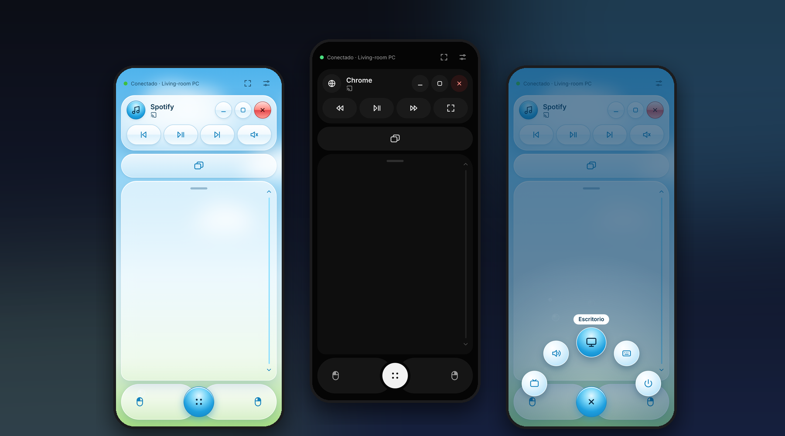
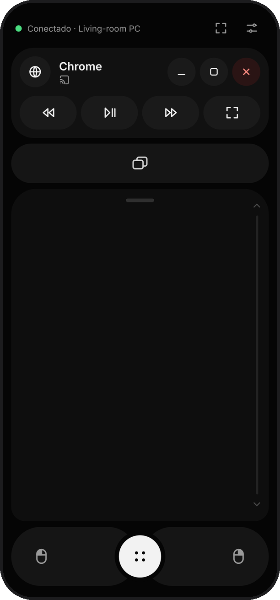
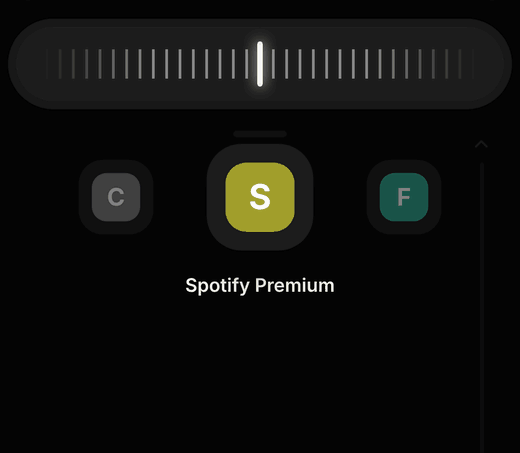
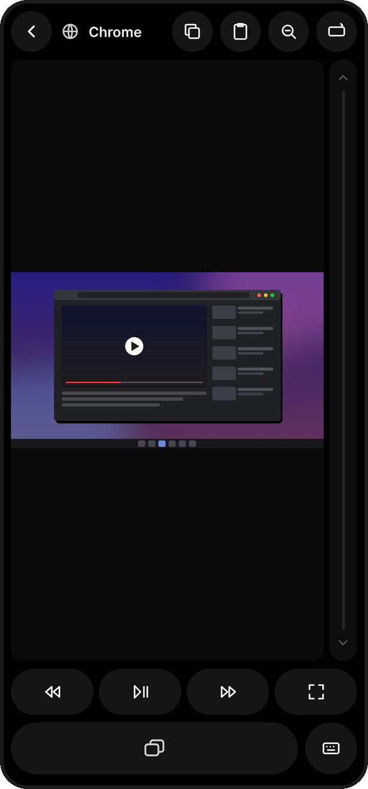
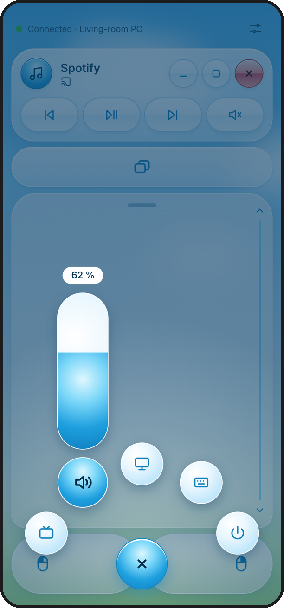
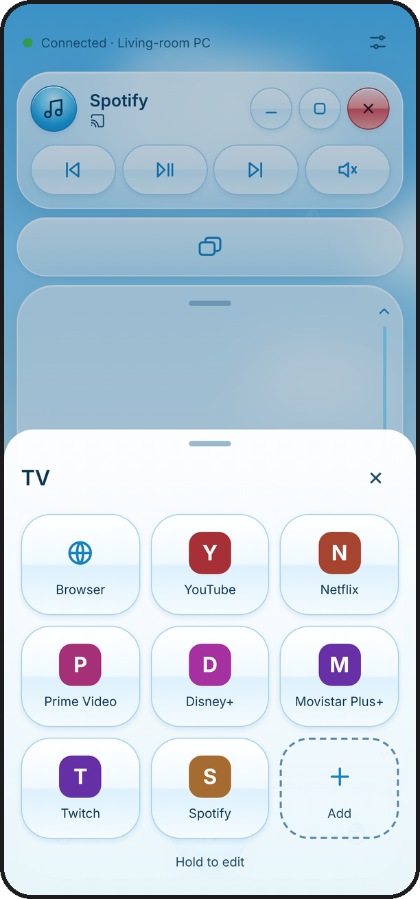
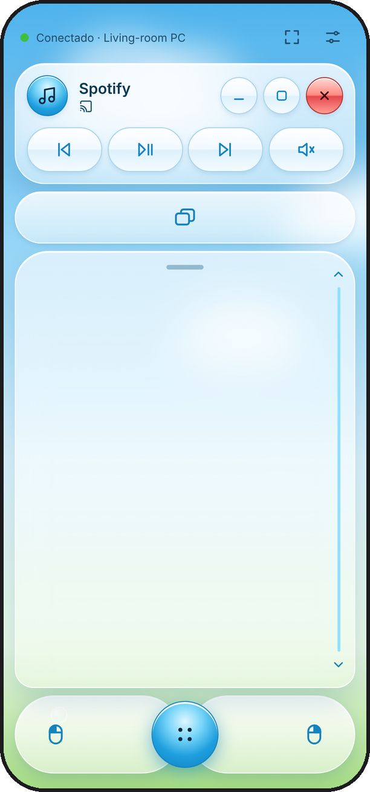
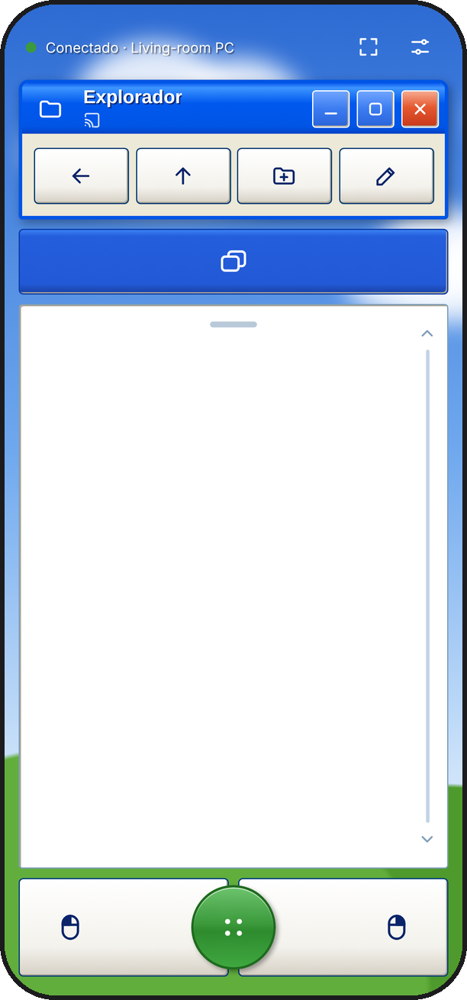
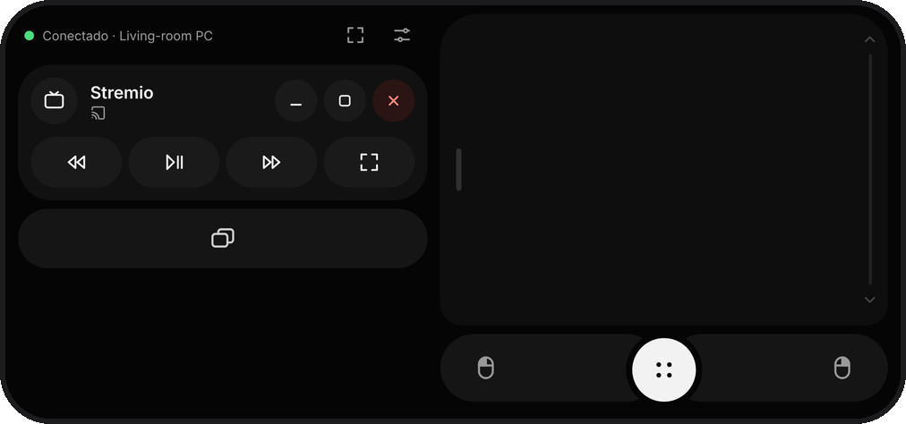

<p align="center">
  
</p>

<h1 align="center">Mando PC</h1>

<p align="center">
  <b>Turn your phone into a couch remote for your Windows PC.</b><br>
  Trackpad, window switching, media controls, your streaming sites and a live view of your screen,<br>
  designed to be used with one thumb, from the sofa or the bed.
</p>

<p align="center">
  <a href="../../releases/latest"><b>⬇ Download for Windows</b></a> ·
  <a href="#features">Features</a> ·
  <a href="#how-it-works">How it works</a> ·
  <a href="#building-from-source">Build from source</a>
</p>

<p align="center">
  
</p>

---

## Why

Remote desktop apps mirror your screen, but controlling a PC from the couch with them is clumsy: tiny targets, no shortcuts, no precision. **Mando PC is built like a remote, not a mirror.** You keep looking at your big screen; the phone gives you a trackpad, the right buttons for whatever app is in front, and nothing else.

- **Nothing to install on the phone.** It runs in the phone's browser and can be added to the home screen like an app.
- **One file on the PC.** Run `MandoPC.exe`, scan the QR code, done.
- **Private by design.** Everything stays on your home network: no accounts, no cloud, no tracking.

## Getting started

1. Download **`MandoPC.exe`** from [Releases](../../releases/latest) and run it.
2. The first time, it will:
   - ask Windows for permission **once** so your phone can connect (click **Yes**),
   - ask whether to start with Windows,
   - show a **QR code**.
3. Scan the QR code with your phone's camera. The phone must be on the same Wi-Fi as the PC.
4. Optional: in Chrome, tap **⋮ → Add to Home screen** to get an app icon.

A short interactive tutorial walks you through everything the first time. Mando PC then lives in the system tray, next to the clock: click it to show the QR code again, toggle **Start with Windows** or quit.

> **"Windows protected your PC"?** The executable isn't signed with a paid code-signing certificate, so SmartScreen may warn you the first time. Click **More info → Run anyway**. You can read every line of the source here, or build it yourself.

## Features

### A trackpad that feels right



- **One finger** moves the cursor, with acceleration: slow for precision, fast to cross the screen.
- **Tap** to click, **two-finger tap** for right click, **double tap and drag** to select.
- **Two fingers** to scroll (with inertia), **pinch** to zoom, the **right edge** works as a scroll bar.
- **Three fingers**: up for Task View, down for the desktop, sideways to switch virtual desktops.
- **Adjustable size**: hold the little bar on top of the trackpad and drag it to bring everything within reach of your thumb.
- **Landscape mode**: card on one side, trackpad on the other. Pick which side in Settings.

<br clear="right">

### The window dial



The capsule under the card is Alt+Tab, reimagined for a touch screen.

- **Tap** it to jump back to the previous window.
- **Hold and slide** to flip through your open windows. Each notch is one window, with a light vibration, and their icons slide past on the phone so you know where you are. Let go to switch.

<br clear="right">

### Smart buttons for the app in front

The card at the top always shows the app you're using on the PC, with its real icon, minimize / maximize / close buttons (close asks for a second tap), and **four shortcuts that change with the app**:

| App in front | Buttons |
|---|---|
| Browser | Back · Reload · New tab · Find |
| YouTube, Netflix, Twitch and other video sites | Rewind · Play/Pause · Forward · Fullscreen |
| Stremio | Rewind · Play/Pause · Forward · Fullscreen |
| Spotify and music players | Previous · Play/Pause · Next · Mute |
| PowerPoint | Previous slide · Start show · Next slide · End show |
| File Explorer | Back · Up · New folder · Rename |
| Documents and editors | Copy · Paste · Undo · Save |
| Desktop | File Explorer · Search · Task View · Windows settings |

### See your screen



Tap the card to see your PC on the phone.

- **Tap** anywhere to click exactly there.
- **Hold** for a magnifier, so you can aim precisely; let go to click.
- **Pinch** to zoom in, drag to move around.
- The same **smart buttons** and **dial** sit under your thumb, and a **scroll line** runs along the side.
- Rotate the phone for a bigger picture: controls move to the edges.

<br clear="right">

### Quick menu



The round button opens a radial menu. Hold and slide to an option, or tap and choose.

- **TV**: your streaming sites, one tap away.
- **Volume**: a vertical slider like the one on your phone. Drag from anywhere to change it from its current level; tap again to mute.
- **Desktop** and **Keyboard**.
- **Power**: lock, sleep, restart or shut down. Hold to confirm, with 10 seconds to cancel.

<br clear="right">

### TV



YouTube, Netflix, Prime Video, Disney+, Twitch, Spotify and your default browser, opened on the PC with one tap.

- **Long press** to edit: icons wiggle and can be removed.
- **+** adds sites from a catalog (Max, Filmin, RTVE Play, DAZN, Crunchyroll…) or any address you type.

<br clear="right">

### And also

- **Type from your phone**: when a text box is active on the PC, a **Write** button appears. Use your phone's keyboard, or dictate.
- **Cursor halo**: a big ring around the mouse pointer, so you can find it from across the room.
- **Haptics**: every action has its own vibration pattern, so you can use the app without looking at it.
- **Copy and paste**, keyboard shortcuts, and a full set of special keys.

## Themes

<p align="center">
  
  &nbsp;
  
  &nbsp;
  
</p>

**Dark** (default), **Light** in a Frutiger Aero style, with glossy buttons, drifting clouds and bubbles, and a **secret theme** for those who find the easter egg.

<p align="center">
  
</p>

## How it works

```
 Phone (browser)                     Windows PC
┌──────────────────┐   Wi-Fi    ┌──────────────────────────────┐
│ index.html       │ ─────────▶ │ server.py                    │
│ touch + gestures │ WebSocket  │ mouse · keyboard · windows   │
│                  │ ◀───────── │ volume · screen capture      │
└──────────────────┘            └──────────────────────────────┘
```

- **`server.py`** (Python, aiohttp) serves the interface to the phone and turns its messages into mouse moves, clicks, key presses and window actions. It also reports the active window, lists open windows for the dial, extracts app icons, captures the screen and reads the system volume.
- **`index.html`** is the entire phone interface in a single file: plain HTML, CSS and JavaScript, no frameworks.
- The link in the QR code carries a **random access key**. Without it, nobody else on your network can control the PC.
- Settings are stored in `%APPDATA%\MandoPC`.

## Building from source

Requires Windows and Python 3.10+.

```bash
pip install -r requirements.txt
python server.py              # with the tray icon
python server.py --sin-icono  # in the console, no tray icon
python server.py --simular    # dry run: logs actions instead of moving the mouse
```

To build the executable yourself, run `compilar.bat`. It creates `dist\MandoPC.exe` with PyInstaller.

On every push to `main`, a GitHub Actions workflow builds `MandoPC.exe` on Windows. When `VERSION` in `server.py` changes, it also publishes the matching release (for example `v1.0`) with the executable attached.

## Notes

- The interface is currently in **Spanish**.
- Mando PC controls a **Windows** PC. The phone side works in any modern mobile browser; it's designed and tested for Android with Chrome.
- Some things depend on Windows and the app you're using: a few browsers don't report text fields (so the **Write** button may not appear there), and the cursor halo can't draw over exclusive-fullscreen games.

## License

[MIT](LICENSE) © 2026 Pablo Grasa
